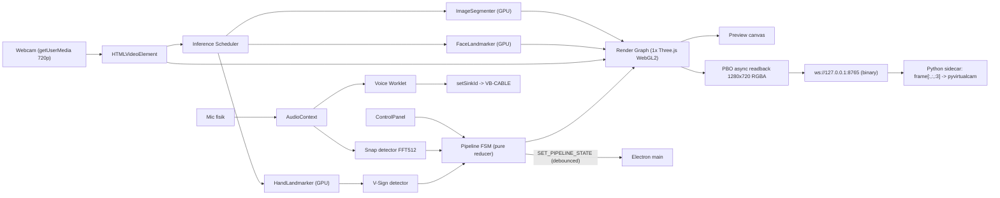

# PhantomCast Studio — Architect Blueprint (v1)

Pemilik: `architect` · Sumber: `PRD_PhantomCast_Studio.md` · Status: siap dipakai untuk implementasi bertahap.
File ini hanya rancangan. Tidak ada perubahan di `src/`, `electron/`, `backend/`, atau `package.json`.

## 0. Bukti lingkungan (sudah diverifikasi di workspace)

| Item | Nilai terpasang | Catatan |
|---|---|---|
| Node | v24.14.0 | Type-stripping native → `scripts/self-check.mjs` bisa `import` modul `.ts` murni (tanpa `enum`/`namespace`, import pakai ekstensi `.ts`; `allowImportingTsExtensions` sudah aktif). |
| Electron | 33.4.11 (Chromium 130) | `protocol.handle` + `net.fetch` tersedia. |
| `@mediapipe/tasks-vision` | **0.10.35** (deklarasi `^0.10.18`) | `wasm/` berisi `vision_wasm_internal.{js,wasm}`, varian `nosimd` dan `module`. |
| `three` | 0.170.0 | `WebGLRenderer.readRenderTargetPixelsAsync` ada (PBO async readback). |
| `kalidokit`, `@pixiv/three-vrm` | terpasang | — |
| CSP | `<meta>` di `index.html` | Lihat §3.4: aman untuk prod, **memblokir Vite HMR** di dev. |

Temuan dari `vision_bundle.mjs` (alasan teknis strategi anti-CSP):
1. Loader WASM disisipkan lewat `document.createElement("script")` dengan **`crossOrigin="anonymous"`**. Di halaman `file://` origin bernilai `null`, sehingga request CORS ke `file://` gagal.
2. Model dimuat dengan **`fetch(modelAssetPath)`**. `fetch` di Chromium tidak mendukung skema `file:`.
3. Kalau `canvas` tidak diberikan, setiap task GPU membuat *backup canvas* sendiri, jadi ada satu konteks WebGL per task.

Kesimpulan: build produksi **tidak boleh** memuat renderer dari `file://`. Lihat §3.

---

## 1. Topologi sistem



Prinsip:
- **Satu sumber kebenaran**: FSM berupa reducer murni `transition(state, event, nowMs) → state`. Bebas DOM dan React, jadi bisa diuji di Node.
- **Satu konteks WebGL untuk render**: compositing, LUT, pixelate, visor, dan VRM semuanya lewat satu `THREE.WebGLRenderer`. MediaPipe diberi canvas eksplisit (`OffscreenCanvas`), satu per task, supaya jumlah konteks terkendali (maksimal 3 untuk MP + 1 untuk render).
- **Waktu berbasis `performance.now()`**, bukan hitungan frame, agar hasilnya sama di 30 dan 60 FPS.

---

## 2. State machine pipeline

### 2.1 Region ortogonal (statechart)

Ada empat region yang berjalan paralel. Kombinasinya **tidak** diledakkan menjadi daftar state datar.

| Region | State | Catatan |
|---|---|---|
| `boot` | `BOOT → LOADING_ASSETS → READY` · `DEGRADED` · `ERROR` | `DEGRADED` = sebagian model gagal dimuat. Fitur yang bergantung pada model itu dimatikan, sisanya tetap jalan. |
| `mode` | `RAW_CAM` · `AR_FILTER` · `VTUBER_3D` | Sesuai `active_mode` di kontrak IPC. |
| `vanish` | `VISIBLE` · `FADING_OUT` · `VANISHED` · `FADING_IN` | Fade 400 ms, bisa dibalik di tengah jalan. |
| `plate` | `NONE` · `CAPTURING` (1000 ms) · `READY` | Clean plate. Strategi latar: `CLEAN_PLATE` atau `AUTO_INFILL`. |

### 2.2 Bentuk state (kontrak untuk `src/engines/pipelineMachine.ts`)

```ts
type ActiveMode = 'RAW_CAM' | 'AR_FILTER' | 'VTUBER_3D';
type VanishPhase = 'VISIBLE' | 'FADING_OUT' | 'VANISHED' | 'FADING_IN';
type TriggerSource = 'GESTURE_V_SIGN' | 'AUDIO_SNAP' | 'MANUAL';
type BgStrategy = 'CLEAN_PLATE' | 'AUTO_INFILL';
type VtuberBg = 'ROOM' | 'SOLID' | 'IMAGE';

interface PipelineState {
  boot: 'BOOT' | 'LOADING_ASSETS' | 'READY' | 'DEGRADED' | 'ERROR';
  mode: ActiveMode;
  vanish: { phase: VanishPhase; progress: number; /*0..1 linear*/ startedAt: number; startProgress: number };
  plate: { phase: 'NONE' | 'CAPTURING' | 'READY'; startedAt: number };
  bgStrategy: BgStrategy;
  vtuberBg: VtuberBg;
  lastToggleAt: number;            // cooldown global
  lastTrigger: TriggerSource | null;
  selectedFilterId: string | null; // 'pixelate-eyes' | 'pixelate-face' | 'neon-visor' | 'lut-warm' | 'lut-mono' | 'lut-anime'
  vtuberModelPath: string | null;  // blob: URL atau app://user/<id>
  triggers: { gesture: boolean; snap: boolean };
}

type PipelineEvent =
  | { type: 'ASSETS_LOADED'; failed: string[] }
  | { type: 'SET_MODE'; mode: ActiveMode }
  | { type: 'TOGGLE_VANISH'; source: TriggerSource }
  | { type: 'CAPTURE_PLATE' }
  | { type: 'TICK' }                 // dipanggil sekali per frame render
  | { type: 'SET_FILTER'; id: string | null }
  | { type: 'SET_VTUBER_MODEL'; path: string | null }
  | { type: 'SET_BG'; strategy?: BgStrategy; vtuberBg?: VtuberBg };
```

### 2.3 Tabel transisi `vanish`

| Dari | Event | Guard | Ke | Efek |
|---|---|---|---|---|
| `VISIBLE` | `TOGGLE_VANISH` | `canToggle` ∧ `hasBackground` | `FADING_OUT` | `startedAt=now`, `startProgress=progress`, `lastToggleAt=now` |
| `FADING_OUT` | `TICK` | `progress ≥ 1` | `VANISHED` | — |
| `FADING_OUT` | `TOGGLE_VANISH` | `canToggle` | `FADING_IN` | dibalik dari `progress` saat ini (tanpa lompatan) |
| `VANISHED` | `TOGGLE_VANISH` | `canToggle` | `FADING_IN` | — |
| `FADING_IN` | `TICK` | `progress ≤ 0` | `VISIBLE` | — |
| `FADING_IN` | `TOGGLE_VANISH` | `canToggle` | `FADING_OUT` | dibalik |

Guard:
- `canToggle = source === 'MANUAL' || now - lastToggleAt ≥ 2000`. Cooldown 2000 ms bersifat **global lintas sumber**, supaya gesture V dan snap yang terjadi bersamaan tidak saling membatalkan. MANUAL selalu lolos, tetapi tetap memperbarui `lastToggleAt`.
- `hasBackground = plate.phase === 'READY' || bgStrategy === 'AUTO_INFILL' || mode === 'VTUBER_3D'`. Pada VTuber, yang memudar adalah avatar, jadi latar sudah pasti ada.
- Trigger yang ditolak oleh guard tidak mengubah state. Kejadian ini dicatat ke HUD sebagai `cooldown` atau `no-plate`.

### 2.4 Matematika fade 400 ms

```
FADING_OUT: progress = clamp(startProgress + (now - startedAt) / 400, 0, 1)
FADING_IN : progress = clamp(startProgress - (now - startedAt) / 400, 0, 1)
v (vanish amount) = progress² · (3 − 2·progress)     // smoothstep, C¹ di 0 dan 1
personAlpha = 1 − v
```
- Pembalikan arah memakai `progress` linear yang sama, sehingga kurva tetap kontinu. Sisa durasi = `400 · progress` untuk FADING_IN, atau `400 · (1 − progress)` untuk FADING_OUT.
- Fade ini adalah output video, bukan animasi UI. `prefers-reduced-motion` **tidak** mengubah durasinya, karena PRD menetapkan 400 ms. Yang mengikuti preferensi itu hanya animasi panel UI.

### 2.5 Aturan pemicu (antarmuka ke `engine-lead`)

- **V-Sign**: detector mengeluarkan event `TOGGLE_VANISH{GESTURE_V_SIGN}` hanya jika pose bertahan ≥ 500 ms. Hold dan toleransi diukur dengan **timestamp**, bukan hitungan frame: celah ≤ 150 ms masih dianggap bertahan. Dengan begitu hasilnya sama walau hand landmarker berjalan 12 Hz (§2.7) atau turun ke 8 Hz saat degradasi. Setelah memicu, detector **wajib melihat pose dilepas** sebelum aktif lagi. Tanpa aturan ini, tangan yang masih membentuk V setelah cooldown 2 s akan men-toggle berulang.
- **Snap**: detector hanya mengeluarkan event saat double-snap valid (200–800 ms). Parameter FFT ada di `engine-math-spec.md`.
- Detector **tidak** menyimpan cooldown sendiri. Cooldown hanya ada di FSM (§2.3), agar tidak ada logika ganda.

### 2.6 Region `mode`: dampak per mode

| Aspek | `RAW_CAM` | `AR_FILTER` | `VTUBER_3D` |
|---|---|---|---|
| Lapisan subjek | kamera | kamera + overlay (pixelate/visor) | avatar VRM/PNG dirender ke RT ber-alpha |
| Yang memudar saat Vanish | piksel tubuh (mask) | piksel tubuh **dan** overlay (`overlayAlpha *= 1−v`) | seluruh RT avatar (`avatarAlpha = 1−v`) |
| Latar saat Vanish | clean plate / infill | clean plate / infill | `ROOM` (clean plate statis bila ada, jika tidak infill) / `SOLID` / `IMAGE` |
| LUT warna | global, di pass terakhir | global, di pass terakhir | global, di pass terakhir |
| Pindah mode | instan. Engine VTuber di-*lazy-load* saat pertama kali masuk dan tetap di memori, tetapi tidak dirender saat mode lain aktif. |

Avatar VRM **tidak** di-fade lewat `material.opacity` MToon karena menimbulkan artefak sorting transparan. Avatar dirender ke `WebGLRenderTarget`, lalu dikomposit dengan satu uniform alpha.

### 2.7 Matriks permintaan inferensi (dipakai scheduler)

| Model | Kondisi aktif | Laju target |
|---|---|---|
| FaceLandmarker | `mode ∈ {AR_FILTER, VTUBER_3D}` | 30 Hz (tetap 30 di mode 60 FPS; render mengisi frame antara dengan One-Euro smoothing) |
| HandLandmarker (`numHands: 1`) | `triggers.gesture` | 12 Hz |
| ImageSegmenter | `vanish ≠ VISIBLE` | 15 Hz |
| ImageSegmenter | `VISIBLE` ∧ `AUTO_INFILL` (belajar latar) | 4 Hz |
| ImageSegmenter | `VTUBER_3D` ∧ `vtuberBg=ROOM` ∧ plate `READY` | **0 Hz** (latar = clean plate statis) |

Scheduler: maksimal **satu inferensi berat per tick render**, round-robin berdasarkan *deadline* (model yang paling lama terlambat dari lajunya dijalankan lebih dulu). Semua task memakai `runningMode: 'VIDEO'` dengan timestamp monoton dari `performance.now()`.

### 2.8 Render graph (fullscreen pass, satu konteks)

```
camTex ─┐
maskTex ─┼─► [Composite] mix(cam, bg, smoothMask · v)  ─► [Subject FX] pixelate/visor·(1−v)
bgTex ──┘          ▲                                          │
                   └─ [Infill accumulate] bg = mix(bg, cam, (1−mask)·k)   (ping-pong RT, hanya AUTO_INFILL)
VTUBER: [Avatar RT] ─► over(bg, avatar·(1−v)) ──────────────────┤
                                                               ▼
                                             [LUT 2D-strip] ─► preview
                                                               └─► [Egress pass: flip-Y, 1280x720] ─► PBO readback
```
- `smoothMask`: mask di-upsample bilinear, diberi feather `smoothstep(0.35, 0.65, m)`, lalu EMA temporal `α=0.6` untuk meredam flicker antar inferensi.
- Clean plate: rata-rata ±30 frame selama `CAPTURING` 1000 ms, disimpan sebagai tekstur, tanpa readback ke CPU.
- Egress pass membalik sumbu Y di shader. Python menerima baris dari atas ke bawah tanpa perlu `np.flipud`, sehingga tidak ada biaya CPU tambahan.

---

## 3. Strategi anti-CSP: local asset loading

### 3.1 Keputusan: skema privileged `app://` di produksi, Vite server di dev

| Lingkungan | URL renderer | Aset |
|---|---|---|
| Dev | `http://localhost:5173/` | Vite melayani `public/` di root → `/wasm/*`, `/models/*` |
| Prod | `app://phantomcast/index.html` | `protocol.handle('app')` → file di `dist/` (di dalam asar) |

Renderer selalu memakai URL **relatif terhadap origin** (`new URL('wasm', location.href)`), sehingga kode yang sama berjalan di dev maupun prod. `vite.config.ts` sudah memakai `base: './'`, dan ini cocok.

### 3.2 Electron main (untuk pemilik `electron/main.ts`)

```ts
import { app, protocol, net, BrowserWindow } from 'electron';
import path from 'node:path';
import { pathToFileURL } from 'node:url';

protocol.registerSchemesAsPrivileged([{ scheme: 'app',
  privileges: { standard: true, secure: true, supportFetchAPI: true, corsEnabled: true, stream: true } }]);
app.commandLine.appendSwitch('disable-features', 'CalculateNativeWinOcclusion'); // jangan freeze saat jendela tertutup

app.whenReady().then(() => {
  const root = path.join(__dirname, '../dist');
  protocol.handle('app', (req) => {
    const rel = decodeURIComponent(new URL(req.url).pathname);
    const file = path.normalize(path.join(root, rel));
    if (!file.startsWith(root)) return new Response('forbidden', { status: 403 }); // cegah path traversal
    return net.fetch(pathToFileURL(file).toString());
  });
  const win = new BrowserWindow({ webPreferences: {
    preload: path.join(__dirname, 'preload.js'), contextIsolation: true, sandbox: true,
    nodeIntegration: false, backgroundThrottling: false } });   // kamera virtual tetap jalan saat minimize
  app.isPackaged ? win.loadURL('app://phantomcast/index.html') : win.loadURL('http://localhost:5173');
});
```
- Origin `app://phantomcast` cocok dengan `'self'`, sehingga script tag ber-`crossOrigin`, `fetch(modelAssetPath)`, dan `instantiateStreaming` semuanya lolos tanpa melonggarkan CSP.
- `net.fetch(file://…)` membaca isi asar secara transparan dan menetapkan MIME berdasarkan ekstensi. **Verifikasi** bahwa `.wasm` dikirim sebagai `application/wasm`. Jika tidak, set header secara eksplisit. Emscripten memang punya fallback `arrayBuffer`, tetapi fallback itu lebih lambat dan memunculkan warning.
- `backgroundThrottling: false` beserta switch occlusion **wajib**. Tanpanya `requestAnimationFrame` berhenti saat jendela diminimalkan, dan Zoom/Meet menerima frame yang membeku.

### 3.3 Pemuatan di renderer (untuk `visionEngine.ts`)

```ts
const base = new URL('./', location.href);
const fileset = await FilesetResolver.forVisionTasks(new URL('wasm', base).href); // tanpa trailing file
const face = await FaceLandmarker.createFromOptions(fileset, {
  baseOptions: { modelAssetPath: new URL('models/face_landmarker.task', base).href, delegate: 'GPU' },
  canvas: new OffscreenCanvas(1, 1), runningMode: 'VIDEO', numFaces: 1,
  outputFaceBlendshapes: true, outputFacialTransformationMatrixes: true });
```
- **Dilarang** memakai URL CDN (`cdn.jsdelivr.net`, `storage.googleapis.com`) di runtime.
- Fallback GPU ke CPU: jika `delegate:'GPU'` melempar error, ulangi dengan `'CPU'`, set `boot=DEGRADED`, dan HUD menampilkan alasannya.
- Model yang gagal dimuat tidak membuat aplikasi crash. FSM menerima `ASSETS_LOADED{failed}` dan fitur terkait dinonaktifkan di UI.
- **Fallback tanpa protokol** (bila diperlukan): main membaca file lewat IPC `fs.readFile`, lalu renderer memakai `baseOptions.modelAssetBuffer: Uint8Array` (didukung di `vision.d.ts`). Jalur ini hanya untuk model. WASM tetap butuh origin http/app.

### 3.4 CSP final

Produksi (tetap di `<meta>`, cocok untuk `app://`):
```
default-src 'self'; script-src 'self' 'wasm-unsafe-eval' blob:; worker-src 'self' blob:;
style-src 'self' 'unsafe-inline'; img-src 'self' data: blob:; media-src 'self' blob: mediastream:;
connect-src 'self' ws://127.0.0.1:* blob: data:; object-src 'none'; base-uri 'none'
```
- D1 (disepakati dengan backend-eng, #9): `ws://127.0.0.1:*` dipakai karena sidecar punya port fallback 8765→8775. Wildcard ini hanya berlaku untuk literal loopback dan tidak membuka host lain.
- Tambahan yang diusulkan: `object-src 'none'; base-uri 'none'`.
- **Masalah dev**: CSP saat ini tidak mengizinkan `ws://localhost:5173` (Vite HMR), sehingga HMR terblokir. Solusi tanpa melonggarkan prod: pindahkan CSP ke header via `session.defaultSession.webRequest.onHeadersReceived` di main, dan tambahkan `ws://localhost:5173` **hanya** bila `!app.isPackaged`. Alternatif yang lebih minimal: Vite `transformIndexHtml` plugin yang menyisipkan origin HMR khusus pada mode `serve`.
- VRM/PNG milik pengguna (drag-and-drop): `URL.createObjectURL(file)` → `GLTFLoader.loadAsync(blobUrl)`. Ini sudah tercakup oleh `connect-src blob:` dan `img-src blob:`. Untuk path dari IPC (`vtuber_model_path`), main membaca buffer lalu renderer memanggil `GLTFLoader.parseAsync(arrayBuffer, '')`. Tidak perlu `file://`.

### 3.5 Pipeline aset dan packaging

- `scripts/download-models.mjs` sudah idempoten dan sudah menulis `.agents/deferred-setup.json` bila unduhan gagal. Script ini konsisten dengan protokol progressive execution.
- Script tersebut menyalin runtime WASM ke **dua** folder (`public/wasm` dan `public/models`). Salinan ke `public/models` duplikat dan menambah ±67 MB ke installer. Usulan: hapus baris `destModels` (perubahan satu baris oleh pemilik script).
- Hanya `vision_wasm_internal.*` (SIMD) dan `vision_wasm_nosimd_internal.*` yang dibutuhkan. `vision_wasm_module_internal.*` bisa disaring untuk menghemat ±11 MB.
- Vite menyalin `public/` ke `dist/`, sehingga aset ikut masuk asar lewat `files: ["dist/**/*"]`. `asarUnpack` tidak diperlukan karena dibaca via `net.fetch`.
- `public/models/` dan `public/wasm/` sudah di `.antigravityignore`, dan memang sebaiknya juga di `.gitignore`.

---

## 4. Anggaran performa

### 4.1 Target kontrak

- CPU < 15% total, dengan acuan i5-1135G7 (4C/8T), yaitu sekitar **1,2 logical core** untuk seluruh proses: main, renderer, GPU process, dan sidecar Python.
- RAM < 350 MB (seluruh pohon proses).
- 30 FPS (Hemat Daya) atau 60 FPS (Performa) pada 720p.

### 4.2 Alokasi CPU (skenario terberat: AR_FILTER + Vanish aktif + gesture + snap, 30 FPS)

| Komponen | Anggaran % CPU total | Teknik |
|---|---|---|
| Electron main + GPU process overhead | 2,0 | Main tidak melakukan apa pun per frame |
| Capture kamera 720p + upload tekstur | 1,5 | `texImage2D(video)` langsung, tanpa canvas 2D |
| FaceLandmarker 30 Hz (GPU) | 2,5 | `numFaces:1` |
| HandLandmarker 12 Hz (GPU) | 1,5 | `numHands:1`, mode VIDEO (tracking, palm detector jarang dijalankan) |
| ImageSegmenter 15 Hz (GPU) | 1,5 | Input 256×256 atau varian landscape 144×256, mask diproses di GPU |
| Render graph (Three.js) | 1,0 | Fullscreen pass, tanpa alokasi per frame |
| Readback + WS send | 1,5 | PBO async ganda (`readRenderTargetPixelsAsync`), buffer pre-alloc |
| Sidecar Python (slice + pyvirtualcam) | 2,0 | `np.frombuffer` tanpa salinan, satu salinan saat `[:,:,:3]` |
| AudioWorklet DSP + FFT snap | 1,0 | FFT di `AnalyserNode` native, bukan FFT JS |
| **Total** | **14,5** | Headroom 0,5 |

Angka di atas adalah **anggaran**, bukan hasil ukur. Wajib diukur dengan Task Manager / `app.getAppMetrics()` setelah integrasi (§6).

### 4.3 Aturan hot path (wajib)

1. Tidak ada `readPixels` sinkron dan tidak ada `getImageData` di loop frame.
2. Tidak ada alokasi per frame (`new Float32Array`, `{...}` landmark): pakai buffer ring yang di-pre-alokasi.
3. React **tidak** dirender ulang per frame. HUD membaca metrik lewat `ref` dan memperbaruinya ≤ 4 Hz.
4. Backpressure egress: lewati frame bila `ws.bufferedAmount > 1280*720*4` (satu frame tertunda). Frame yang dilewati dihitung dan ditampilkan di HUD.
5. `SET_PIPELINE_STATE` dikirim hanya saat state berubah (debounce 50 ms), bukan per tick.
6. Clock render: `requestAnimationFrame` dibatasi ke target FPS (30 → render setiap ≥ 33,3 ms). Inferensi hanya dijalankan bila video menghasilkan frame baru (cek `video.currentTime`/`requestVideoFrameCallback`).

### 4.4 Mode 30 vs 60 FPS

| | Hemat Daya | Performa |
|---|---|---|
| Render/preview | 30 | 60 |
| Inferensi wajah | 30 Hz | 30 Hz + One-Euro interpolation |
| Egress ke kamera virtual | 30 | 60 (opsional, lihat Q1) |
| Resolusi internal | 720p | 720p/1080p (egress tetap 1280×720 sesuai kontrak) |

### 4.5 Degradasi adaptif (otomatis, bertingkat)

Jika rata-rata waktu frame 2 detik > 90% dari anggaran (33 ms / 16 ms), turunkan satu tingkat. Naikkan kembali setelah 10 detik stabil di bawah 60%.
1. Segmenter 15 → 10 Hz, hand 12 → 8 Hz.
2. Face 30 → 20 Hz (One-Euro menutup celah).
3. Render 60 → 30 FPS.
4. Bila segmenter hanya tersedia lewat delegate `CPU` (GPU gagal), segmenter tidak dijalankan terus-menerus. `AUTO_INFILL` dinonaktifkan dan Vanish hanya diizinkan dengan clean plate (mask 10 Hz).

### 4.6 Anggaran RAM (target)

| Bagian | MB |
|---|---|
| Electron main + GPU proc baseline | ~110 |
| Renderer (React + Three + JS heap) | ~70 |
| WASM heap MediaPipe + 3 model (face 3,6 / hand 7,8 / seg 0,25 MB file) | ~60 |
| Tekstur & RT (cam, bg, mask, ping-pong, avatar, egress, PBO×2 @720p) | ~35 |
| Model VRM tipikal (≤ 20 MB file) | ~40 |
| Sidecar Python (numpy + pyvirtualcam) | ~35 |
| **Total** | **~350** — ketat. Tolak VRM > 60 MB dengan pesan yang jelas, dan unload model lama sebelum memuat model baru (`VRMUtils.deepDispose`). |

---

## 5. Pembagian kepemilikan file (agar fase build tidak bentrok)

| File | Pemilik | Kontrak dari blueprint ini |
|---|---|---|
| `src/engines/pipelineMachine.ts` | engine-lead | §2.2–2.4: reducer murni, tanpa import DOM, TS yang bisa di-strip |
| `src/engines/visionEngine.ts` (+scheduler) | engine-lead | §2.7, §3.3 |
| `src/engines/snapDetector.ts`, `vtuberEngine.ts`, `voiceChangerWorklet.ts` | engine-lead | §2.5, §2.6, `engine-math-spec.md` |
| `src/components/VideoStage.tsx` (render graph + egress) | engine-lead / ui-specialist | §2.8, §4.3 |
| `ControlPanel.tsx`, `PerformanceHUD.tsx`, token desain | ui-specialist | Menampilkan state FSM, alasan `DEGRADED`, frame drop, dan status cooldown |
| `electron/main.ts`, `preload.ts` | backend-eng | §3.2, §3.4 (CSP header dev), IPC |
| `backend/virtual_bridge.py` | backend-eng | §2.8 (frame sudah flip-Y, RGBA 1280×720) |
| `scripts/self-check.mjs` | engine-lead | §6 |

---

## 6. Pemeriksaan wajib (runnable check)

`npm test` → `scripts/self-check.mjs`. Node 24 dapat meng-import `pipelineMachine.ts` secara langsung. Assertion minimum:
1. `VISIBLE` + `TOGGLE{GESTURE}` → `FADING_OUT`. Setelah `TICK` pada t+400 → `VANISHED`. Pada t+200, `v === 0.5`.
2. Toggle kedua dari GESTURE pada t+1500 **ditolak** (cooldown). MANUAL pada t+1500 **diterima**.
3. Pembalikan di t+100 (progress 0,25) → `FADING_IN` dengan `startProgress 0,25`, dan mencapai `VISIBLE` pada t+100+100.
4. `TOGGLE` di `RAW_CAM` tanpa plate dan tanpa `AUTO_INFILL` → ditolak (`hasBackground=false`).
5. Asset check: `public/wasm/vision_wasm_internal.wasm` dan ketiga model ada dengan ukuran > 1 KB. Jika belum ada, catat ke `deferred-setup.json`; **jangan gagal keras**.

Pemeriksaan manual setelah integrasi: build prod dimuat dari `app://` dengan DevTools Console bersih dari pelanggaran CSP, Zoom menerima frame saat jendela diminimalkan, dan `app.getAppMetrics()` menunjukkan total CPU < 15% di skenario §4.2.

---

## 7. Risiko & pertanyaan terbuka

| # | Hal | Usulan |
|---|---|---|
| Q1 | Apakah anggaran < 15% CPU juga berlaku untuk egress 60 FPS? 60 FPS menggandakan bandwidth WS (±221 MB/s) dan CPU sidecar. | Anggaran 15% mengikat untuk Hemat Daya. Performa 60 FPS = preview 60, egress default 30 (bisa diubah pengguna). **Butuh keputusan coordinator.** |
| Q2 | Kontrak `STREAM_VIDEO_FRAME` mengunci 1280×720. Output 1080p butuh header ukuran. | backend-eng: pertimbangkan header 8-byte `(w:u16,h:u16,seq:u32)` atau tetapkan egress hanya 720p. |
| R1 | Versi tasks-vision terpasang 0.10.35, sedangkan deklarasi `^0.10.18`. | Tidak masalah (semver kompatibel), tetapi sinkronkan file WASM lewat `download:models` setiap kali `npm install` agar versi JS dan WASM selalu cocok. |
| R2 | Konteks WebGL MediaPipe (3) + Three (1). | Masih di bawah batas Chromium (~16). Pantau event `webglcontextlost` dan pulihkan dengan inisialisasi ulang task. |
| R3 | Format pyvirtualcam tidak mendukung RGBA, sehingga slice `[:,:,:3]` menghasilkan view non-kontigu dan pyvirtualcam akan menyalin. | Diterima (sekitar 2,7 MB memcpy per frame). Itu sebabnya ada alokasi 2% di §4.2. |
