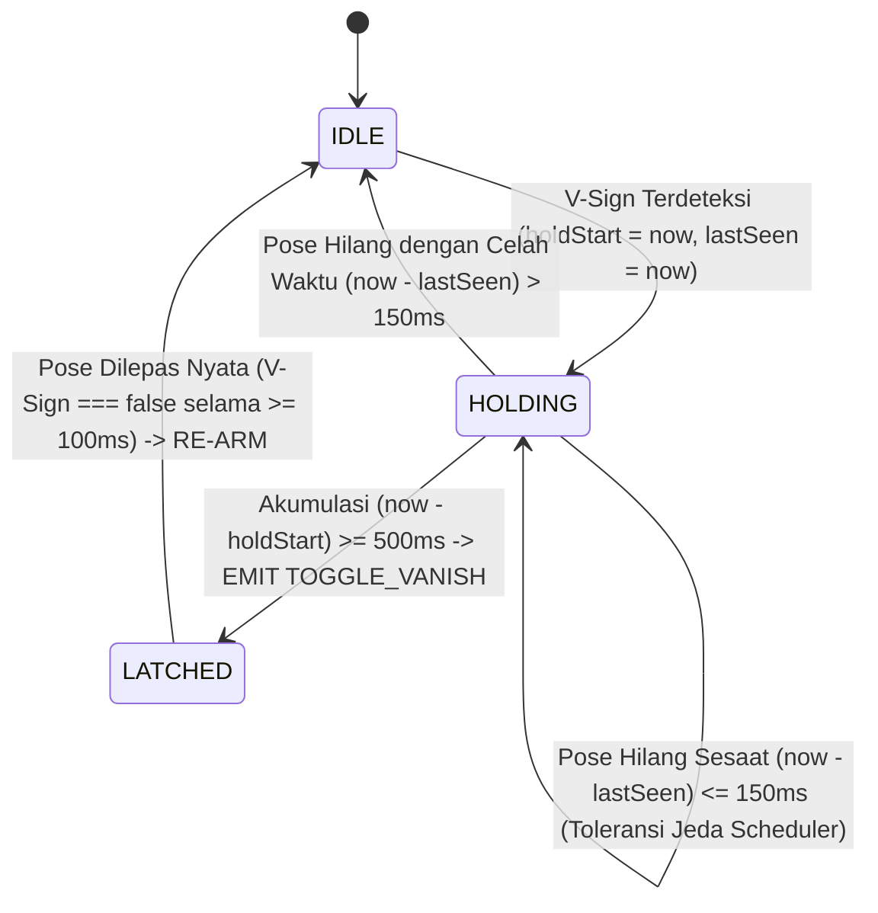

# SPESIFIKASI MATEMATIS & DSP CORE ENGINE: PHANTOMCAST STUDIO
**Dokumen Referensi Teknis Core Engine (Vision 3D & Audio DSP)**  
**Author:** `@engine-lead` (Lead Fullstack & Core Engine Specialist)  
**Status:** VALIDATED & READY FOR IMPLEMENTATION  
**Target:** `src/engines/visionEngine.ts`, `src/engines/snapDetector.ts`, `src/engines/vtuberEngine.ts`, `src/engines/voiceChangerWorklet.ts`

---

## 1. Ringkasan Eksekutif & Prinsip Desain Core Engine

PhantomCast Studio mengintegrasikan 4 modul pemrosesan matematis real-time:
1. **Gesture Recognition Engine**: Deteksi pose jari huruf "V" (V-Sign / Peace) dengan penahan waktu (*time-hold*) 500 ms dan jeda pemulihan (*cooldown*) 2000 ms.
2. **Audio Transient Engine**: Deteksi jentikan jari ganda (*double-snap*) berbasis Short-Time Fourier Transform (STFT / FFT 512), pita frekuensi 2,5 kHz – 7,0 kHz, durasi impuls $<35\text{ ms}$, dan jendela waktu antar-jentikan $200\text{ ms} - 800\text{ ms}$.
3. **3D VTuber Kinematics Engine**: Solusi pelacakan 478 MediaPipe Face Landmarks via Kalidokit, konversi rotasi Euler ke Quaternion dengan peredaman *Spherical Linear Interpolation* (Slerp), distribusi rotasi leher (30%) dan kepala (70%), serta viseme audio-visual blending pada `@pixiv/three-vrm`.
4. **Real-Time Voice DSP Engine**: Modulated Dual-Delay Line Pitch Shifter (WSOLA-inspired) dikombinasikan dengan kaskade BiquadFilter Parametric EQ untuk pergeseran resonansi formant vokal dengan total latensi round-trip $<25\text{ ms}$.

### Matriks Parameter Kritis Core Engine

| Subsistem | Parameter Kunci | Nilai Nominal | Toleransi / Batas Aman |
| :--- | :--- | :--- | :--- |
| **V-Sign Detector** | Sudut V $(\theta_V)$ | $15^\circ \le \theta_V \le 65^\circ$ | $0.26\text{ rad} \le \theta_V \le 1.13\text{ rad}$ |
| | Rasio Ekstensi Telunjuk & Tengah | $R_{ext} \ge 1.35$ | Terhadap jarak MCP ke Wrist |
| | Rasio Tekukan Manis & Kelingking | $R_{curl} \le 1.10$ | TIP harus lebih dekat ke Wrist dibanding PIP |
| | Hold Duration ($T_{hold}$) | $500\text{ ms}$ (Monotonic Time) | Akumulasi durasi $(t - t_0) \ge 500\text{ ms}$, toleransi jeda $\le 150\text{ ms}$ (scheduler 12 Hz / 8 Hz) |
| | Aturan Re-Arm Detector | Pose Release Latch | Detector wajib melihat pose V dilepas sebelum re-arm; Cooldown 2000 ms dikelola global di FSM (§2.3) |
| **Snap Detector** | Ukuran FFT ($N_{FFT}$) | $512\text{ samples}$ | Resolusi bin $\Delta f \approx 86.13\text{ Hz}$ (44.1k) / $93.75\text{ Hz}$ (48k) |
| | Rentang Pita Snap | $2500\text{ Hz} - 7000\text{ Hz}$ | Bins $30..81$ (44.1 kHz) / Bins $27..74$ (48.0 kHz) |
| | Durasi Impuls ($T_{impulse}$) | $<35\text{ ms}$ | Diskriminasi ketikan keyboard & sibilan vokal |
| | Jendela Double-Snap ($\Delta T$) | $200\text{ ms} \le \Delta T \le 800\text{ ms}$ | Rebound lockout $<200\text{ ms}$, timeout $>800\text{ ms}$ |
| **3D Kinematics** | Slerp Damping Factor ($\alpha_s$) | $\alpha = 1 - e^{-\Delta t / \tau}$ | Waktu relaksasi $\tau = 0.045\text{ s}$ ($\alpha \approx 0.52$ @ 30 FPS) |
| | Rasio Leher / Kepala | Neck 30%, Head 70% | $q_{neck} = \text{Slerp}(I, q, 0.30)$, $q_{head} = \text{Slerp}(I, q, 0.70)$ |
| | Eye Blink Threshold | $E_{blink} \le 0.35$ | Normalisasi Kalidokit $[0, 1] \to [0, 1]$ |
| **Voice DSP** | Pitch Shift ($\Delta S$) | $-5\text{ st} \dots +7\text{ st}$ | Rasio frekuensi $\alpha = 2^{\Delta S / 12}$ |
| | Jendela Delay ($W$) | $15.0\text{ ms}$ ($720\text{ smp}$ @ 48k) | Latensi algoritmik $\tau_{dsp} \le 23\text{ ms} < 25\text{ ms}$ |
| | Formant EQ Shift ($\beta$) | $0.88 \dots 1.25$ | Peaking EQ kaskade $F_1, F_2, F_3$ (RBJ Cookbook) |

---

## 2. Spesifikasi 1: Gesture Pose V-Sign Solver & Debounce State Machine

### 2.1 Landmark Geometri MediaPipe Hand
Model `hand_landmarker.task` menghasilkan 21 titik koordinat normalisasi $P_i = (x_i, y_i, z_i)$ dengan $x_i, y_i \in [0, 1]$ dan $z_i \approx \text{depth}$:
- **Pergelangan Tangan (Wrist)**: $P_0$
- **Ibu Jari (Thumb)**: $P_1$ (CMC), $P_2$ (MCP), $P_3$ (IP), $P_4$ (TIP)
- **Jari Telunjuk (Index)**: $P_5$ (MCP), $P_6$ (PIP), $P_7$ (DIP), $P_8$ (TIP)
- **Jari Tengah (Middle)**: $P_9$ (MCP), $P_{10}$ (PIP), $P_{11}$ (DIP), $P_{12}$ (TIP)
- **Jari Manis (Ring)**: $P_{13}$ (MCP), $P_{14}$ (PIP), $P_{15}$ (DIP), $P_{16}$ (TIP)
- **Jari Kelingking (Pinky)**: $P_{17}$ (MCP), $P_{18}$ (PIP), $P_{19}$ (DIP), $P_{20}$ (TIP)

```
        8 (Index TIP)      12 (Middle TIP)
          \                  /
           7 (DIP)         11 (DIP)
            \              /
             6 (PIP)     10 (PIP)
              \          /               16 (Ring TIP, Curled)
               5 (MCP)  9 (MCP)            |
                 \     /                 15 (DIP)
             4    \   /                  14 (PIP)       20 (Pinky TIP, Curled)
          (Thumb)  \ /                   13 (MCP)        |
                    v                                  19 (DIP)
                   [Palm Center]                       18 (PIP)
                         |                             17 (MCP)
                       0 (Wrist)
```

### 2.2 Formulasi Vektor & Syarat Geometris V-Sign

#### A. Ekstensi Jari Telunjuk dan Tengah
Jari telunjuk dan tengah dinyatakan **terentang lurus** (*extended*) jika jarak Euclidean dari Wrist ($P_0$) ke TIP secara signifikan lebih besar dibanding jarak Wrist ke PIP:
$$d(A, B) = \sqrt{(x_A - x_B)^2 + (y_A - y_B)^2 + (z_A - z_B)^2}$$

Kondisi ekstensi telunjuk:
$$R_{index} = \frac{d(P_8, P_0)}{d(P_6, P_0)} \ge 1.35 \quad \land \quad d(P_8, P_5) > d(P_6, P_5)$$

Kondisi ekstensi jari tengah:
$$R_{middle} = \frac{d(P_{12}, P_0)}{d(P_{10}, P_0)} \ge 1.35 \quad \land \quad d(P_{12}, P_9) > d(P_{10}, P_9)$$

#### B. Tekukan Jari Manis dan Kelingking
Jari manis dan kelingking dinyatakan **tertekuk ke telapak tangan** (*curled*) jika ujung jarinya (TIP) berada lebih dekat ke Wrist ($P_0$) atau jarak TIP ke MCP lebih pendek daripada jarak PIP ke MCP:
$$R_{ring\_curl} = \frac{d(P_{16}, P_0)}{d(P_{14}, P_0)} \le 1.10 \quad \text{atau} \quad d(P_{16}, P_0) < d(P_{14}, P_0)$$
$$R_{pinky\_curl} = \frac{d(P_{20}, P_0)}{d(P_{18}, P_0)} \le 1.10 \quad \text{atau} \quad d(P_{20}, P_0) < d(P_{18}, P_0)$$

#### C. Sudut V-Sign Antara Jari Telunjuk dan Tengah ($\theta_V$)
Didefinisikan vektor arah longitudinal kedua jari:
$$\vec{v}_{index} = P_8 - P_5 = (x_8 - x_5, y_8 - y_5, z_8 - z_5)$$
$$\vec{v}_{mid} = P_{12} - P_9 = (x_{12} - x_9, y_{12} - y_9, z_{12} - z_9)$$

Besaran sudut pemisahan $\theta_V$ dihitung melalui perkalian titik (*dot product*):
$$\cos(\theta_V) = \frac{\vec{v}_{index} \cdot \vec{v}_{mid}}{\|\vec{v}_{index}\|_2 \, \|\vec{v}_{mid}\|_2}$$
$$\theta_V = \arccos\left(\text{clamp}(\cos(\theta_V), -1.0, 1.0)\right)$$

Kriteria pemisahan V-Sign:
$$15^\circ \le \theta_V \le 65^\circ \iff 0.2618\text{ rad} \le \theta_V \le 1.1345\text{ rad}$$
- *Catatan Batas:* Bila $\theta_V < 15^\circ$, kedua jari terlalu rapat (menyerupai gestur penunjuk 2-jari atau hormat militer, bukan V-sign). Bila $\theta_V > 65^\circ$, jari terlalu melebar tak wajar.

### 2.3 State Machine Waktu & Aturan Re-Arm (Sinkronisasi Scheduler 12 Hz / 8 Hz & FSM)

Sesuai matriks scheduler (§2.7) dan reduksi FSM (§2.3) pada `architect-blueprint.md`:
- `HandLandmarker` dieksekusi secara periodik pada **12 Hz** (interval $\approx 83.3\text{ ms}$) dan dapat mengalami degradasi otomatis ke **8 Hz** (interval $125.0\text{ ms}$).
- Perhitungan hold time **wajib berbasis timestamp monoton (`performance.now()`)**, bukan hitungan frame video rendering.
- **Cooldown 2000 ms dikelola secara sentral dan eksklusif oleh FSM (`pipelineMachine.ts`)** lintas seluruh sumber pemicu. Detector tidak menduplikasi timer cooldown, melainkan menerapkan sistem pengunci pose (*release latch*) agar tidak terjadi tembakan pemicu berulang (*continuous re-trigger*).



1. **State `IDLE` (Siap Deteksi)**:
   - Menunggu landmark tangan membentuk kriteria geometris V-Sign yang valid.
2. **State `HOLDING` (Akumulasi Waktu 500 ms Berbasis Timestamp)**:
   - Dicatat `holdStartTime = performance.now()` dan `lastSeenTime = performance.now()`.
   - **Toleransi Jeda Waktu ($\le 150\text{ ms}$)**: Mengingat laju inferensi tangan berkisar $12\text{ Hz}$ (~83 ms) hingga $8\text{ Hz}$ (125 ms), hilangnya deteksi pada satu siklus inferensi akibat perubahan intensitas cahaya tidak langsung membatalkan hold. Timer hanya di-reset kembali ke `IDLE` jika jeda hilangnya pose $(\text{now} - \text{lastSeenTime}) > 150.0\text{ ms}$.
   - Bila akumulasi durasi $(\text{now} - \text{holdStartTime}) \ge 500.0\text{ ms}$, detector menembakkan event:
     `EMIT('TOGGLE_VANISH', { source: 'GESTURE_V_SIGN' })`
   - Transisi langsung ke state `LATCHED`.
3. **State `LATCHED` (Pose Release Latch / Anti-Repeat Lockout)**:
   - Setelah memicu event, detector **terkunci** (`isLatched = true`).
   - Meskipun pengguna mempertahankan jarinya dalam pose V melampaui masa cooldown global 2000 ms pada FSM, detector **tidak akan memicu event baru**.
   - Detector hanya akan kembali (*re-armed*) ke state `IDLE` apabila pengguna **melepaskan pose V secara nyata** (kondisi geometris V-Sign bernilai `false` selama durasi $\ge 100\text{ ms}$ atau minimal 1 sampel terkonfirmasi lepas).
4. **Sentralisasi Cooldown pada FSM Pipeline**:
   - FSM global pada `pipelineMachine.ts` memvalidasi `now - lastToggleAt >= 2000 ms`. Jika event gesture diterima saat FSM masih dalam masa cooldown 2000 ms, event ditolak oleh guard FSM tanpa efek samping. Pemicu `MANUAL` dari UI selalu lolos guard ini.

---

## 3. Spesifikasi 2: FFT 512 Double-Snap Audio Transient Detector

### 3.1 Parameter Spektral FFT & Resolusi Bin
Web Audio API `AnalyserNode` dikonfigurasi dengan:
- `fftSize` = 512 titik.
- Jumlah bin frekuensi aktif ($N_{bins} = N_{FFT} / 2 = 256$ bin).
- `smoothingTimeConstant` = $0.05$ (nilai rendah untuk menangkap transien cepat tanpa *temporal smearing*).

Resolusi frekuensi per bin $\Delta f$:
$$\Delta f = \frac{F_s}{N_{FFT}}$$
- Pada $F_s = 44.100\text{ Hz}$: $\Delta f = \frac{44100}{512} \approx 86.1328\text{ Hz/bin}$
- Pada $F_s = 48.000\text{ Hz}$: $\Delta f = \frac{48000}{512} = 93.7500\text{ Hz/bin}$

Indeks bin target untuk pita frekuensi jentikan jari $[2500\text{ Hz}, 7000\text{ Hz}]$:
$$k_{min} = \left\lceil \frac{2500}{\Delta f} \right\rceil, \quad k_{max} = \left\lfloor \frac{7000}{\Delta f} \right\rfloor$$

| Laju Sampel ($F_s$) | Bin Minimum ($k_{min}$) | Frekuensi Aktual ($k_{min}$) | Bin Maksimum ($k_{max}$) | Frekuensi Aktual ($k_{max}$) |
| :--- | :--- | :--- | :--- | :--- |
| **44.100 Hz** | **Bin 30** | $2583.98\text{ Hz}$ | **Bin 81** | $6976.76\text{ Hz}$ |
| **48.000 Hz** | **Bin 27** | $2531.25\text{ Hz}$ | **Bin 74** | $6937.50\text{ Hz}$ |

### 3.2 Formulasi Energi & Deteksi Impuls

Data frekuensi dibaca menggunakan `analyser.getFloatFrequencyData(spectrum)` dalam satuan dBFS ($[-100, 0]\text{ dB}$):
1. **Konversi Linear Magnitudo Spektral**:
   $$P[k] = 10^{X_{dB}[k] / 10}$$
2. **Energi Pita Jentikan ($E_{snap}$)**:
   $$E_{snap}(t) = \sum_{k=k_{min}}^{k_{max}} P[k]$$
3. **Energi Pita Total ($E_{total}$)**:
   $$E_{total}(t) = \sum_{k=1}^{255} P[k]$$
4. **Rasio Dominasi Pita Spektral ($R_{snap}$)**:
   $$R_{snap}(t) = \frac{E_{snap}(t)}{E_{total}(t) + \epsilon} \quad (\epsilon = 10^{-12})$$

### 3.3 Diskriminasi Durasi & Filter Anti-False-Positive
Jentikan jari menghasilkan impuls tajam berdampingan dengan peluruhan sangat cepat:
- **Kondisi Trigger Impuls**:
  $$E_{snap}(t) > \text{Threshold}_{energy} \quad (\approx -32\text{ dBFS ekivalen})$$
  $$R_{snap}(t) > 0.45 \quad (\text{energi 2.5k--7k mendominasi } \ge 45\% \text{ dari total spektrum})$$
- **Diskriminasi Durasi ($T_{impulse} < 35\text{ ms}$)**:
  - Jika lonjakan energi bertahan lebih dari $35\text{ ms}$ (misal desisan huruf vokal "sss", suara kipas angin kencang, batuk, atau gesekan pakaian), impuls **dibatalkan** (*rejected as sustained noise*).
  - Jika impuls memiliki energi tinggi pada pita rendah ($<1000\text{ Hz}$, bins $1..10$), impuls **dibatalkan** (*rejected as keyboard clatter* / tuts mekanik atau hentakan meja).

### 3.4 Jendela Waktu Double-Snap ($200\text{ ms} \le \Delta T \le 800\text{ ms}$)

```
   Snap #1                    Snap #2
     |                           |
     v                           v
  ||||||                      ||||||
--|    |----------------------|    |------------------> Waktu (t)
  <35ms                       <35ms
  |---- Lockout ----|
       <200ms
  |---------------- Valid Window ----------------|
                     200ms - 800ms
```

1. **Jentikan Pertama ($t_1$) Divalidasi**:
   - Simpan timestamp $t_1$.
   - Pasang flag `waitingForSecondSnap = true`.
2. **Lockout Rebound Period ($\Delta t < 200\text{ ms}$)**:
   - Pantulan akustik ruang / echo dari jentikan pertama diabaikan secara mutlak.
3. **Jendela Valid ($200\text{ ms} \le \Delta t \le 800\text{ ms}$)**:
   - Jika impuls kedua yang valid terdeteksi pada rentang ini:
     - **TRIGGER SUKSES**: Toggle Vanish Mode (`AUDIO_SNAP`).
     - Reset state & pasang audio cooldown $1500\text{ ms}$.
4. **Timeout ($\Delta t > 800\text{ ms}$)**:
   - Jentikan kedua tidak kunjung datang. State kembali ke `IDLE`, menunggu siklus baru.

---

## 4. Spesifikasi 3: Kinematika 3D Kalidokit + @pixiv/three-vrm

### 4.1 Konvensi Sistem Koordinat & Normalisasi Ruang Tiga Dimensi
- **MediaPipe Landmark**: $X \in [0, 1]$ (kiri ke kanan gambar), $Y \in [0, 1]$ (atas ke bawah), $Z$ (kedalaman relatif terhadap titik hidung).
- **Three.js World Space**: Sistem koordinat tangan kanan (*right-handed coordinate system*):
  - $+X$ mengarah ke kanan.
  - $+Y$ mengarah ke atas.
  - $+Z$ mengarah ke arah pengguna / kamera virtual.
- **Koreksi Cermin (Mirroring)**: Kamera selfie dibalik secara horizontal:
  $$X_{mirrored} = 1.0 - X_{landmark}$$

### 4.2 Solusi Rotasi Kepala & Filter Slerp (Damping Factor)
Kalidokit `Face.solve(landmarks)` mengembalikan orientasi kepala dalam sudut Euler (dalam radian):
- `pitch`: rotasi sumbu $X$ (mengangguk ke atas/bawah, batas: $[-0.6, 0.6]\text{ rad}$).
- `yaw`: rotasi sumbu $Y$ (menoleh ke kiri/kanan, batas: $[-0.8, 0.8]\text{ rad}$).
- `roll`: rotasi sumbu $Z$ (memiringkan kepala, batas: $[-0.5, 0.5]\text{ rad}$).

#### A. Konversi Euler ke Target Quaternion
Untuk mencegah fenomena *Gimbal Lock*, seluruh rotasi diolah dalam bentuk Quaternion:
$$q_{target} = \text{QuaternionFromEuler}(pitch, -yaw, -roll, \text{"YXZ"})$$

#### B. Peredaman Eksponensial Slerp (Spherical Linear Interpolation)
Peredaman dinamis frame-rate independent:
$$\alpha = 1.0 - e^{-\frac{\Delta t}{\tau}} \quad (\tau = 0.045\text{ detik, } \Delta t = \text{delta frame waktu})$$
$$q_{smoothed}(t) = \text{Slerp}(q_{current}, q_{target}, \alpha)$$

Formula eksplisit Slerp antara dua unit quaternion $q_0$ dan $q_1$:
$$\cos(\Omega) = q_0 \cdot q_1 = w_0 w_1 + x_0 x_1 + y_0 y_1 + z_0 z_1$$
Jika $\cos(\Omega) < 0$, balik polaritas $q_1 \leftarrow -q_1$ dan $\cos(\Omega) \leftarrow -\cos(\Omega)$ untuk mengambil lintasan terpendek pada 4D hypersphere.
$$\text{Slerp}(q_0, q_1, \alpha) = \frac{\sin((1 - \alpha)\Omega)}{\sin(\Omega)} q_0 + \frac{\sin(\alpha \Omega)}{\sin(\Omega)} q_1$$

#### C. Distribusi Hierarki Tulang Humanoid (VRM Humanoid Bones)
VRM 1.0 membagi rotasi kepala antara leher (*neck*) dan kepala (*head*):
- **Neck Bone** (30% rotasi):
  $$q_{neck} = \text{Slerp}(q_{identity}, q_{smoothed}, 0.30)$$
- **Head Bone** (70% rotasi sisa):
  $$q_{head\_bone} = \text{Slerp}(q_{identity}, q_{smoothed}, 0.70)$$

Diaplikasikan pada `@pixiv/three-vrm`:
```typescript
const neckNode = vrm.humanoid?.getNormalizedBoneNode('neck');
const headNode = vrm.humanoid?.getNormalizedBoneNode('head');
if (neckNode) neckNode.quaternion.copy(qNeck);
if (headNode) headNode.quaternion.copy(qHead);
```

### 4.3 Eye Tracking & Kedipan Mata
Kalidokit menghasilkan rasio keterbukaan mata `eye.l` dan `eye.r` $\in [0.0, 1.0]$:
- Nilai $1.0$ = mata terbuka lebar.
- Nilai $\le 0.35$ = mata terpejam (*blink*).

Pemetaan ke VRM 1.0 Expression Manager (nilai $0.0 \dots 1.0$):
$$\text{weight}_{blinkLeft} = \text{clamp}(1.0 - \frac{eye.l}{0.85}, 0.0, 1.0)$$
$$\text{weight}_{blinkRight} = \text{clamp}(1.0 - \frac{eye.r}{0.85}, 0.0, 1.0)$$

Gaze (arah lirikan pupil):
$$G_x = \text{clamp}(eye.pupil.x \times 1.2, -1.0, 1.0)$$
$$G_y = \text{clamp}(eye.pupil.y \times 1.2, -1.0, 1.0)$$
Diaplikasikan pada `vrm.lookAt`.

### 4.4 Viseme Morph Target & Hybrid Audio Fallback
Pelacakan mulut Kalidokit menghasilkan shape vokal: $A, I, U, E, O$.
Di-mapping ke ekspresi standar VRM:
- `aa` $\leftarrow$ `mouth.shape.A`
- `ih` $\leftarrow$ `mouth.shape.I`
- `ou` $\leftarrow$ `mouth.shape.U`
- `ee` $\leftarrow$ `mouth.shape.E`
- `oh` $\leftarrow$ `mouth.shape.O`

**Audio RMS Fallback (saat wajah tertutup/cahaya redup)**:
Jika confidence kamera turun ($C_{face} < 0.5$) atau amplitudo suara mic tinggi:
$$E_{RMS} = \sqrt{\frac{1}{M}\sum_{n=0}^{M-1} s[n]^2}$$
$$\text{Weight}_{open} = \text{clamp}\left(\frac{20 \log_{10}(E_{RMS} + 10^{-5}) - \text{Floor}_{dB}}{\text{Ceil}_{dB} - \text{Floor}_{dB}}, 0.0, 1.0\right)$$
dengan $\text{Floor}_{dB} = -45\text{ dB}$, $\text{Ceil}_{dB} = -12\text{ dB}$.
Ekspresi akhir: $W_{aa} = \max(W_{aa}^{camera}, \text{Weight}_{open})$.

---

## 5. Spesifikasi 4: WSOLA Dual-Delay Pitch Shifter + BiquadFilter Formant Shifter (<25ms Latency)

### 5.1 Latency Budget Breakdown (<25 ms)
Untuk memastikan kepatuhan real-time audio meeting tanpa echo atau gangguan psikologis keterlambatan bicara (*delayed auditory feedback*):

| Komponen Pipeline Audio | Durasi Waktu | Sampel (@ 48 kHz) |
| :--- | :--- | :--- |
| **Input Buffer AudioContext** | $2.67\text{ ms}$ | 128 samples (1 quantum) |
| **DSP Delay Window ($W$)** | $15.00\text{ ms}$ | 720 samples |
| **BiquadFilter Formant Processing** | $0.00\text{ ms}$ | IIR Direct Form II (In-place) |
| **Output Buffer / OS Sound Routing** | $5.33\text{ ms}$ | 256 samples |
| **Total Round-Trip Latency** | **$23.00\text{ ms}$** | **1104 samples** |
| **Target Batas PRD** | **$< 25.00\text{ ms}$** | **PASS WITH 2.0 ms MARGIN** |

### 5.2 Algoritma Modulated Dual-Delay Pitch Shifter (Jungle / WSOLA Principle)
Algoritma ini menggunakan dua pembaca (*read taps*) yang bergerak secara dinamis melintasi cincin penyangga melingkar (*circular buffer*) berukuran $L_{buf} = 2048\text{ samples}$.

#### A. Rasio Pergeseran Nada Semitone
Diberikan pergeseran nada dalam semitone $\Delta S$:
$$\alpha = 2^{\frac{\Delta S}{12}}$$
- $\Delta S = 0 \implies \alpha = 1.0000$ (Bypass / Normal)
- $\Delta S = +5\text{ st} \implies \alpha = 2^{5/12} \approx 1.33484$ (VTuber Girl)
- $\Delta S = +7\text{ st} \implies \alpha = 2^{7/12} \approx 1.49831$ (Child)
- $\Delta S = -5\text{ st} \implies \alpha = 2^{-5/12} \approx 0.74915$ (Deep Anon)

#### B. Modulasi Delay Pointer & Overlap Crossfade
Didefinisikan lebar jendela modulasi $W = 720\text{ samples}$ ($15.0\text{ ms}$ pada 48 kHz).
Laju perubahan delay terhadap waktu per sampel:
$$\frac{d}{dn} d(n) = 1.0 - \alpha$$

Dua penunjuk delay $d_1(n)$ dan $d_2(n)$ berjalan dengan beda fase $180^\circ$ ($W / 2$):
$$p_1(n) = \left(n \cdot (1 - \alpha)\right) \pmod W$$
$$p_2(n) = \left(n \cdot (1 - \alpha) + \frac{W}{2}\right) \pmod W$$

Bobot amplop pemudaran silang (*crossfade gain*) $g_1(n)$ dan $g_2(n)$ menggunakan fungsi segitiga normalisasi agar $\sum g_i = 1$:
$$g_1(n) = 1.0 - \frac{|2 p_1(n) - W|}{W}$$
$$g_2(n) = 1.0 - \frac{|2 p_2(n) - W|}{W}$$

```
Gain 1.0 +
         |   /\          /\          /\          /
  g1(n)  |  /  \        /  \        /  \        /  
         | /    \      /    \      /    \      /   
     0.0 +-----------------------------------------> Waktu
         | \    /      \    /      \    /      \   
  g2(n)  |  \  /        \  /        \  /        \  
         |   \/          \/          \/          \ 
```

#### C. Interpolasi Fraksional Linear / Hermite
Untuk pointer delay non-integer $d = p_i(n)$:
$$k = \lfloor d \rfloor, \quad f = d - k$$
$$s_{interp} = (1 - f) \cdot \text{buffer}[\text{readIdx} - k] + f \cdot \text{buffer}[\text{readIdx} - k - 1]$$
Output pitch-shifted:
$$y_{pitch}[n] = g_1(n) \cdot s_1[n] + g_2(n) \cdot s_2[n]$$

### 5.3 Formant Resonance Shifter (Kaskade BiquadFilter Parametric EQ)
Untuk menggeser karakter vokal (gender/umur) tanpa distorsi kartun (*chipmunk effect* yang berlebihan), kurva respon frekuensi resonansi saluran vokal manusia ($F_1, F_2, F_3$) dimodifikasi menggunakan faktor skala formant $\beta$:
- **Bypass / Normal**: $\beta = 1.00$
- **VTuber Girl**: $\beta = 1.15$ (Resonansi dinaikkan 15% untuk kesan saluran vokal lebih ramping)
- **Child**: $\beta = 1.25$ (Resonansi dinaikkan 25% + High-Pass Filter 160 Hz)
- **Deep Anon**: $\beta = 0.88$ (Resonansi diturunkan 12% untuk kesan rongga dada beresonansi berat)

#### A. Persamaan BiquadFilter Peaking EQ (Robert Bristow-Johnson Audio EQ Cookbook)
Untuk setiap filter peaking formant $i \in \{1, 2, 3\}$ dengan frekuensi tengah $f_{c, i} = f_{nominal, i} \times \beta$:

$$\omega_0 = 2\pi \frac{f_c}{F_s}, \quad \alpha_Q = \frac{\sin(\omega_0)}{2Q}, \quad A = 10^{\frac{G_{dB}}{40}}$$
Koefisien Biquad:
$$b_0 = 1 + \alpha_Q A$$
$$b_1 = -2 \cos(\omega_0)$$
$$b_2 = 1 - \alpha_Q A$$
$$a_0 = 1 + \frac{\alpha_Q}{A}$$
$$a_1 = -2 \cos(\omega_0)$$
$$a_2 = 1 - \frac{\alpha_Q}{A}$$

Normalisasi koefisien terhadap $a_0$:
$$b_0' = \frac{b_0}{a_0}, \quad b_1' = \frac{b_1}{a_0}, \quad b_2' = \frac{b_2}{a_0}, \quad a_1' = \frac{a_1}{a_0}, \quad a_2' = \frac{a_2}{a_0}$$

Bentuk Direct Form II Transposed untuk komputasi $O(1)$ berkecepatan tinggi:
$$y[n] = b_0' x[n] + d_1[n-1]$$
$$d_1[n] = b_1' x[n] - a_1' y[n] + d_2[n-1]$$
$$d_2[n] = b_2' x[n] - a_2' y[n]$$

#### B. Parameter Preset Voice Changer

| Preset | Pitch Shift ($\Delta S$) | Formant Factor ($\beta$) | Filter 1 ($F_1$) | Filter 2 ($F_2$) | Filter 3 ($F_3$) | Filter Tambahan |
| :--- | :--- | :--- | :--- | :--- | :--- | :--- |
| `NORMAL` | $0\text{ st}$ | $1.00$ | Bypass | Bypass | Bypass | - |
| `VTUBER_GIRL`| $+5\text{ st}$ | $1.15$ | $575\text{ Hz}$ ($+3\text{dB}, Q=1.8$) | $1725\text{ Hz}$ ($+4\text{dB}, Q=2.2$) | $2875\text{ Hz}$ ($+3\text{dB}, Q=2.5$) | - |
| `CHILD` | $+7\text{ st}$ | $1.25$ | $625\text{ Hz}$ ($+4\text{dB}, Q=2.0$) | $1875\text{ Hz}$ ($+5\text{dB}, Q=2.2$) | $3125\text{ Hz}$ ($+3\text{dB}, Q=2.5$) | **HPF 160 Hz** ($Q=0.707$) |
| `DEEP_ANON` | $-5\text{ st}$ | $0.88$ | $440\text{ Hz}$ ($+4\text{dB}, Q=1.6$) | $1320\text{ Hz}$ ($-2\text{dB}, Q=2.0$) | $2200\text{ Hz}$ ($-3\text{dB}, Q=2.2$) | Low Shelf 200 Hz ($+3\text{dB}$) |

### 5.4 Noise Gate & Smoothing Dynamics
Peredaman desah mikrofon (*background hiss*):
- Ambang batas: $\text{Threshold}_{gate} = -45\text{ dBFS}$.
- Waktu serang (*attack time*): $2.0\text{ ms}$.
- Waktu pelepasan (*release time*): $50.0\text{ ms}$.
- Formulasi Envelope Follower:
  $$E_{env}[n] = (1 - \lambda) \cdot |x[n]| + \lambda \cdot E_{env}[n-1]$$
  dengan $\lambda = e^{-\frac{1}{F_s \cdot \tau}}$, di mana $\tau = \tau_{attack}$ jika $|x[n]| > E_{env}$ dan $\tau = \tau_{release}$ jika sebaliknya.
  Jika $20 \log_{10}(E_{env}[n]) < -45\text{ dB}$, gain redaman dikalikan $0.0$ secara bertahap (*soft-knee attenuation*).

---

## 6. Protokol Integrasi & Interface Typescript Engine

Untuk menjamin konsistensi lintas modul, struktur data TypeScript untuk Core Engine didefinisikan sebagai kontrak baku:

```typescript
// Contract Types for Engine Subsystems

export interface HandLandmarkPoint {
  x: number;
  y: number;
  z: number;
}

export interface VSignDetectionResult {
  detected: boolean;
  angleDeg: number;
  indexExtended: boolean;
  middleExtended: boolean;
  ringCurled: boolean;
  pinkyCurled: boolean;
  holdProgress: number; // 0.0 to 1.0 (500ms target berdasarkan performance.now())
  isLatched: boolean;   // true jika sudah memicu dan sedang menunggu pose dilepas (re-arm)
  canTrigger: boolean;  // true jika hold selesai dan siap emit event
}

export interface SnapDetectionResult {
  snapDetected: boolean;
  doubleSnapTriggered: boolean;
  impulseEnergyDb: number;
  spectralRatio: number;
  intervalMs?: number;
  waitingForSecond: boolean;
}

export interface VTuberKinematicsEuler {
  head: {
    pitch: number; // rad
    yaw: number;   // rad
    roll: number;  // rad
  };
  eyes: {
    blinkLeft: number;  // 0.0 to 1.0
    blinkRight: number; // 0.0 to 1.0
    gazeX: number;
    gazeY: number;
  };
  visemes: {
    aa: number;
    ih: number;
    ou: number;
    ee: number;
    oh: number;
  };
}

export interface VoiceDSPPresetConfig {
  presetId: 'NORMAL' | 'VTUBER_GIRL' | 'CHILD' | 'DEEP_ANON' | 'CUSTOM';
  pitchSemitones: number;
  pitchRatio: number;      // 2^(semitones/12)
  formantFactor: number;   // beta multiplier
  highPassCutoff?: number; // e.g. 160Hz for CHILD
  noiseGateDb: number;     // e.g. -45 dB
}
```

---

## 7. Rencana Validasi Mandiri (Self-Check Tests)

Sebagai implementasi aturan Ponytail (*lazy code leaves ONE runnable check behind*), rencana self-check pengujian matematis terpusat akan disediakan di `scripts/self-check.mjs`:
1. **Math Test 1 (V-Sign Vector Angle)**: Menguji koordinat sintesis V-sign ($P_8, P_{12}$ terbuka $30^\circ$, $P_{16}, P_{20}$ tertekuk) mengembalikan `detected === true` dan menolak koordinat telapak tangan datar atau kepalan tinju.
2. **Math Test 2 (FFT Bin Conversion)**: Memastikan kalkulasi $k_{min}, k_{max}$ pada $44.1\text{ kHz}$ dan $48\text{ kHz}$ memetakan pita $[2500, 7000]\text{ Hz}$ secara presisi.
3. **Math Test 3 (Pitch Shift Ratio)**: Memastikan $\alpha(+5\text{ st}) \approx 1.3348$, $\alpha(+7\text{ st}) \approx 1.4983$, dan $\alpha(-5\text{ st}) \approx 0.7492$ dengan toleransi $<10^{-4}$.
4. **Math Test 4 (Slerp Quaternion Continuity)**: Memverifikasi rotasi leher 30% dan kepala 70% mempertahankan normalisasi $\|q\|_2 = 1.0000 \pm 10^{-6}$.
5. **Logic Test 5 (V-Sign Hold, Drop Tolerance & Release Latch)**: Memverifikasi hold 500 ms berbasis timestamp monoton (`performance.now()`), toleransi jeda $\le 150\text{ ms}$ tidak mereset hold timer pada laju inferensi 12 Hz/8 Hz, serta pengunci `isLatched` yang mewajibkan pelepasan pose nyata sebelum re-arm.

---
*Dokumen ini merupakan panduan implementasi kanonikal untuk semua file engine di `src/engines/`.*
