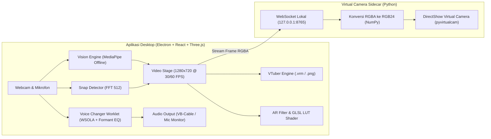

# PhantomCast Studio

[](https://github.com/Eugenewijaya/phantomcast/releases/latest)
[-00F59B?style=flat-square)](https://github.com/Eugenewijaya/phantomcast/releases/latest)
[](#fitur-utama)
[](./LICENSE)

**PhantomCast Studio** adalah aplikasi kamera dan mikrofon virtual desktop untuk Windows 10/11. Dirancang untuk rapat daring (Zoom, Google Meet, Microsoft Teams, Discord) maupun kreator konten, PhantomCast memungkinkan pengguna menghilang secara halus dari layar kamera menggunakan gestur tangan atau jentikan jari, mengganti tampilan wajah menjadi karakter 3D/2D (`.vrm` dan `.png`), menggunakan filter privasi AR, serta mengubah karakter suara secara langsung (*real-time*) tanpa bergantung pada server eksternal.

- **Website & Simulator 3D Interaktif**: [https://eugenewijaya.github.io/phantomcast/](https://eugenewijaya.github.io/phantomcast/)
- **Unduh Rilis Terbaru (`v1.0.0`)**: [https://github.com/Eugenewijaya/phantomcast/releases/tag/v1.0.0](https://github.com/Eugenewijaya/phantomcast/releases/tag/v1.0.0)

---

## Unduh Aplikasi (Windows 10 / 11 64-bit)

| Paket Distribusi | Ukuran | Deskripsi | Tautan Unduh |
| :--- | :--- | :--- | :--- |
| **PhantomCast Studio Setup 1.0.0.exe** | 153.9 MB | Installer standar Windows (NSIS) dengan pintasan Desktop & Start Menu | [**Download Installer (.exe)**](https://github.com/Eugenewijaya/phantomcast/releases/download/v1.0.0/PhantomCast.Studio.Setup.1.0.0.exe) |
| **PhantomCast Studio 1.0.0.exe** | 153.7 MB | Versi *Portable Standalone* (langsung berjalan tanpa instalasi) | [**Download Portable (.exe)**](https://github.com/Eugenewijaya/phantomcast/releases/download/v1.0.0/PhantomCast.Studio.1.0.0.exe) |
| **virtual_bridge.exe** | 20.4 MB | Modul jembatan kamera virtual mandiri (sudah termasuk di dalam installer utama) | [**Download Sidecar (.exe)**](https://github.com/Eugenewijaya/phantomcast/releases/download/v1.0.0/virtual_bridge.exe) |

> **Catatan Integrasi Perangkat Virtual Windows:**
> - **Kamera Virtual**: Agar keluaran video terbaca di Zoom / Google Meet, pastikan sistem memiliki driver **OBS Virtual Camera** (terpasang otomatis bersama OBS Studio v28+, tanpa perlu membuka OBS saat rapat).
> - **Mikrofon Virtual**: Pasang driver **VB-CABLE Virtual Audio Device** apabila ingin meneruskan keluaran Voice Changer ke input mikrofon aplikasi rapat.

---

## Fitur Utama

### 1. Vanish Mode (Menghilang Halus dari Kamera)
- **Clean Plate & Auto Background Infill**: Menyimpan tangkapan latar ruangan kosong sebelum rapat atau memisahkan siluet tubuh secara otomatis menggunakan segmentasi lokal.
- **Transisi Fade 400ms**: Memudarkan opasitas subjek secara halus tanpa mematikan aliran kamera sehingga tampilan ruangan tetap terlihat alami.
- **Pemicu Gestur & Suara**:
  - **Pose Jari "V"**: Mengangkat jari telunjuk dan tengah membentuk huruf "V" selama `500 ms` (dilengkapi *cooldown* pengaman `2 detik`).
  - **Double-Snap (Jentikan Jari Ganda)**: Deteksi spektrum frekuensi `2.5 kHz – 7.0 kHz` berdurasi `<35 ms` untuk dua jentikan jari dalam rentang `200 ms – 800 ms`.

### 2. Local VTuber Studio (`.vrm` & `.png`)
- **Impor Karakter Lokal**: Mendukung *drag-and-drop* berkas model 3D `.vrm` (standar VRoid Studio / Booth) serta gambar `.png` (PNGTuber) langsung dari komputer, lengkap dengan model 3D bawaan (`HoloUnit-01`).
- **Pelacakan Wajah & Bibir Real-Time**: Mengubah 478 titik koordinat wajah dan amplitudo suara mikrofon menjadi rotasi kepala (*roll, pitch, yaw*), kedipan mata, dan gerak mulut vokal (`aa, ih, ou, ee, oh`) menggunakan `Three.js`, `@pixiv/three-vrm`, dan `Kalidokit`.
- **Kustomisasi Latar Avatar**: Pilihan latar ruangan asli, warna solid, atau gambar latar kustom.

### 3. Filter Wajah AR & Shader Warna
- **Cyber Visor 3D**: Kacamata hologram 3D yang mengikuti kemiringan dan rotasi kepala secara presisi.
- **Privacy Pixelate**: Sensor mozaik piksel otomatis yang melacak area wajah secara langsung.
- **Cinematic & Anime Color LUT**: Shader WebGL GLSL untuk gradasi warna *Warm Cinema*, *Noir Monochrome*, dan *Anime Cel-Shading*.

### 4. Real-Time Voice Changer DSP (`<25ms`)
Pemrosesan sinyal suara berbasis `AudioWorkletProcessor` menggunakan algoritma **Modulated Dual-Delay Line (WSOLA)** dan kaskade **BiquadFilter Formant EQ**:
- **Normal (Bypass)**: Suara asli mikrofon dengan *Noise Gate* `-45 dB`.
- **Wanita / Anime**: Pitch `+5 semitone`, Formant `+15%`.
- **Anak-Anak**: Pitch `+7 semitone`, Formant `+25%`, High-Pass Filter `160 Hz`.
- **Anonim / Berat**: Pitch `-5 semitone`, Formant `-12%`.
- Dilengkapi pemilih perangkat keluaran audio (`setSinkId`) untuk **VB-Audio Virtual Cable** serta tombol **Mic Monitor** independen.

---

## Arsitektur Sistem



---

## Struktur Proyek

```text
phantomcast/
├── backend/
│   ├── requirements.txt           # Dependensi Python untuk jembatan kamera virtual
│   └── virtual_bridge.py          # Server WebSocket lokal & pengirim frame ke pyvirtualcam
├── docs/
│   └── index.html                 # Landing page & simulator 3D (GitHub Pages)
├── electron/
│   ├── main.ts                    # Proses utama Electron & manajemen lifecycle sidecar
│   └── preload.ts                 # Jembatan IPC terisolasi (contextBridge)
├── public/
│   ├── models/                    # Lokasi model AI lokal (.task, .tflite)
│   └── wasm/                      # Lokasi runtime WebAssembly lokal (.wasm)
├── scripts/
│   ├── download-models.mjs        # Skrip pengunduh aset model MediaPipe lokal
│   ├── build-sidecar.py           # Skrip kompilasi sidecar via PyInstaller
│   ├── self-check.mjs             # Pengujian unit & integrasi otomatis
│   └── verify-dev-runtime.mjs     # Pengujian runtime development
├── src/
│   ├── components/
│   │   ├── VideoStage.tsx         # Kanvas komposit utama 60 FPS
│   │   ├── ControlPanel.tsx       # Panel kontrol mode, avatar, filter AR, & Voice DSP
│   │   └── PerformanceHUD.tsx     # Indikator FPS, deteksi gestur, & level audio
│   ├── engines/
│   │   ├── visionEngine.ts        # Pelacakan tangan, wajah, & segmentasi latar
│   │   ├── snapDetector.ts        # Detektor jentikan jari ganda berbasis FFT
│   │   ├── vtuberEngine.ts        # Loader & solver kinematika .vrm / .png
│   │   ├── arFilterShader.ts      # Efek AR wajah & shader warna WebGL
│   │   └── voiceChangerWorklet.ts # Pemroses suara real-time AudioWorklet
│   ├── types/
│   │   └── phantomcast.ts
│   ├── App.tsx
│   └── main.tsx
├── package.json
└── vite.config.ts
```

---

## Panduan Pengembangan dari Kode Sumber

### Prasyarat
- **Node.js** v20+ dan **npm**
- **Python** 3.10+ (untuk modul jembatan kamera virtual)

### 1. Instalasi Dependensi & Model Lokal
```powershell
npm install
npm run download:models
```

### 2. Persiapan Environment Python
```powershell
python -m venv backend/venv
.\backend\venv\Scripts\pip.exe install -r backend/requirements.txt
```

### 3. Menjalankan Mode Development
```powershell
# Pemeriksaan tipe TypeScript
npm run typecheck

# Menjalankan pengujian otomatis
npm test

# Menjalankan aplikasi dalam mode development
npm run dev
```

### 4. Membangun Installer Windows (`.exe`)
```powershell
npm run build:exe
```
Hasil kompilasi installer dan aplikasi portable akan disimpan di dalam direktori `release/`.

---

## Lisensi
Didistribusikan di bawah lisensi [MIT License](./LICENSE).
