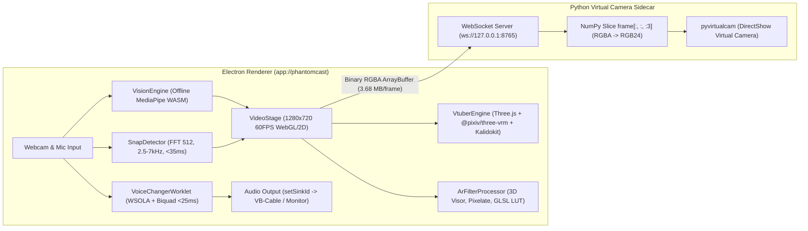

# PhantomCast Studio (`.exe`)

[](https://github.com/Eugenewijaya/phantomcast/releases/latest)
[-34D399?style=flat-square)](https://github.com/Eugenewijaya/phantomcast/releases/latest)
[](#3-real-time-voice-changer-dsp-phase-3)
[](./LICENSE)

**PhantomCast Studio** adalah perangkat lunak middleware kamera dan mikrofon virtual desktop mandiri (`.exe`) untuk Windows 10/11. Aplikasi ini memproses umpan webcam dan mikrofon fisik secara lokal menggunakan akselerasi WebGL, MediaPipe Tasks Vision (100% offline), Three.js VRM/PNGTuber kinematics, serta AudioWorklet DSP berlatensi rendah (`<25ms`), lalu meneruskannya ke Zoom, Google Meet, Microsoft Teams, dan Discord.

- **Landing Page & Unduhan Resmi**: [https://eugenewijaya.github.io/phantomcast/](https://eugenewijaya.github.io/phantomcast/)
- **Halaman Rilis GitHub (`v1.0.0`)**: [https://github.com/Eugenewijaya/phantomcast/releases/tag/v1.0.0](https://github.com/Eugenewijaya/phantomcast/releases/tag/v1.0.0)

---

## Unduh Langsung (Windows 10 / 11 64-bit)

| Paket Distribusi | Ukuran | Kegunaan | Tautan Unduh |
| :--- | :--- | :--- | :--- |
| **PhantomCast Studio Setup 1.0.0.exe** | ~153.9 MB | Installer standar Windows (NSIS) dengan pintasan Desktop & Start Menu | [**Unduh Installer (.exe)**](https://github.com/Eugenewijaya/phantomcast/releases/download/v1.0.0/PhantomCast.Studio.Setup.1.0.0.exe) |
| **PhantomCast Studio 1.0.0.exe** | ~153.7 MB | Aplikasi *Portable Standalone* (langsung jalan tanpa instalasi) | [**Unduh Portable (.exe)**](https://github.com/Eugenewijaya/phantomcast/releases/download/v1.0.0/PhantomCast.Studio.1.0.0.exe) |
| **virtual_bridge.exe** | ~20.4 MB | Binary sidecar mandiri PyVirtualCam (`ws://127.0.0.1:8765`) | [**Unduh Sidecar (.exe)**](https://github.com/Eugenewijaya/phantomcast/releases/download/v1.0.0/virtual_bridge.exe) |

> **Prasyarat Driver Virtual Windows (Opsional untuk Zoom / Meet):**
> - **Kamera Virtual**: Pastikan sistem memiliki **OBS Virtual Camera** (terpasang otomatis bersama OBS Studio v28+, tanpa perlu membuka OBS saat rapat).
> - **Mikrofon Virtual**: Pasang driver gratis **VB-CABLE Virtual Audio Device** untuk merutekan keluaran Voice Changer (`setSinkId`) ke mikrofon rapat daring.

---

## Arsitektur Sistem (Lightweight Hybrid Stack)



| Parameter Teknis | Spesifikasi Target & Implementasi |
| :--- | :--- |
| **Platform Target** | Windows 10 / 11 (64-bit NSIS Installer & Portable `.exe`) |
| **Target Frame Rate** | 30 FPS (Mode Hemat Daya) atau 60 FPS (Mode Performa) pada resolusi `1280x720` |
| **Konsumsi Sumber Daya** | `<15% CPU` (throttling telemetri HUD 12.5 Hz, pre-allocated NumPy `RGB24` buffer) |
| **Latensi Audio (Voice DSP)** | `<25 ms` (`18.0 ms – 23.0 ms` round-trip dengan jendela WSOLA `720 sampel` @ 48 kHz) |
| **Keamanan & Anti-CSP** | Skema `app://phantomcast`, `contextIsolation: true`, `sandbox: true`, aset AI 100% lokal di `public/models/` & `public/wasm/` |

---

## Fitur Utama

### 1. Vanish Mode & Pemicu Ganda (Visual & Audio)
- **Clean Plate & Auto Background Infill**: Menangkap latar ruangan kosong sebelum rapat atau memisahkan piksel tubuh secara otomatis menggunakan `MediaPipe ImageSegmenter` (`selfie_segmenter.tflite`).
- **Transisi Halus 400ms**: Memudarkan opasitas subjek secara mulus (`400ms` fade-out / fade-in) tanpa mematikan aliran kamera.
- **Pemicu Pose Jari Huruf "V" (`visionEngine.ts`)**: Mengenali telunjuk (Landmark 8) dan jari tengah (Landmark 12) terbuka membentuk sudut V (`7°–75°`) sementara jari manis & kelingking tertekuk selama **500 ms** (toleransi dropout `<=150ms`, *release-latch*, dan *cooldown* **2 detik**).
- **Pemicu Suara Double-Snap (`snapDetector.ts`)**: Menggunakan Web Audio API **FFT 512** untuk mendeteksi dua lonjakan energi frekuensi tinggi (`2.500 Hz – 7.000 Hz`) berdurasi singkat (`<35 ms`) dalam rentang waktu **200 ms hingga 800 ms**.

### 2. Local VTuber Studio & Filter Wajah AR
- **Drag-and-Drop `.vrm` & `.png` (`vtuberEngine.ts`)**: Memuat avatar 3D standar VRoid/Booth (`.vrm` via `@pixiv/three-vrm`) maupun PNGTuber (`.png`) langsung dari penyimpanan lokal komputer, dilengkapi model 3D bawaan (`HoloUnit-01`).
- **Kinematika Wajah 478 Titik (`kalidokit`)**: Mengonversi koordinat `MediaPipe FaceLandmarker` dan amplitudo RMS mikrofon menjadi rotasi kepala (*roll, pitch, yaw*), kedipan mata kiri/kanan, dan sinkronisasi bibir vokal (`aa, ih, ou, ee, oh`).
- **Filter Wajah AR & Shader GLSL (`arFilterShader.ts`)**:
  - **Cyber Visor 3D**: Kacamata hologram 3D yang menempel di pangkal hidung dan mata mengikuti orientasi kepala.
  - **Privacy Pixelate**: Sensor mozaik piksel otomatis yang melacak area wajah secara real-time.
  - **Cinematic & Anime LUT**: Shader fragmen WebGL GLSL untuk gradasi warna *Warm Cinema*, *Noir Monochrome*, dan *Anime Cel-Shading*.

### 3. Real-Time Voice Changer DSP (`voiceChangerWorklet.ts`)
Berjalan di thread audio khusus (`AudioWorkletProcessor`) menggunakan algoritma **Modulated Dual-Delay Line (WSOLA / Jungle)** dengan jendela modulasi `15.0 ms` (`720 sampel` @ 48 kHz) dan kaskade **BiquadFilter Formant Shifter** ($F_1, F_2, F_3$):
- **Normal (Bypass)**: Pitch `0 st`, Formant `1.00`, Noise Gate `-45 dB`.
- **Wanita / Anime (`VTUBER_GIRL`)**: Pitch `+5 semitone`, Formant `+15%` (`1.15`).
- **Anak-Anak (`CHILD`)**: Pitch `+7 semitone`, Formant `+25%` (`1.25`), High-Pass Filter `160 Hz`.
- **Anonim / Berat (`DEEP_ANON`)**: Pitch `-5 semitone`, Formant `-12%` (`0.88`).
- **Audio Output Routing (`setSinkId`) & Mic Monitor**: Jalur keluaran ke **VB-Audio Virtual Cable** dipisahkan dari jalur **Mic Monitor** lokal sehingga menonaktifkan monitor headphone tidak membisukan keluaran mikrofon virtual.

### 4. Python Virtual Camera Bridge (`backend/virtual_bridge.py`)
- Menerima `ArrayBuffer` biner `RGBA` (`1280x720x4 = 3.686.400 byte`) dari `OffscreenCanvas` melalui WebSocket lokal `ws://127.0.0.1:8765`.
- Memotong kanal alpha menggunakan NumPy (`frame[:, :, :3]`) ke buffer C-contiguous `RGB24` dan meneruskannya ke driver kamera virtual Windows via `pyvirtualcam`.
- Dikelola otomatis sebagai proses *sidecar* oleh `electron/main.ts` saat aplikasi dibuka dan dihentikan bersih (`taskkill /PID <pid> /T /F`) saat aplikasi ditutup.

---

## Struktur Direktori

```text
phantomcast-studio/
├── .antigravityignore
├── .gitignore
├── PRD_PhantomCast_Studio.md
├── docs/                          # Landing page GitHub Pages
│   └── index.html
├── public/
│   ├── models/                    # Aset offline MediaPipe (.task, .tflite)
│   └── wasm/                      # Runtime WebAssembly MediaPipe (.wasm, .js)
├── backend/
│   ├── requirements.txt           # pyvirtualcam, websockets, numpy, opencv-python-headless, pyinstaller
│   └── virtual_bridge.py          # Server WS 8765 RGBA -> RGB24 (frame[:, :, :3]) -> PyVirtualCam
├── electron/
│   ├── main.ts                    # Lifecycle window Electron, protokol app://, & sidecar Python
│   └── preload.ts                 # ContextBridge IPC terisolasi (SET_PIPELINE_STATE, SET_VOICE_DSP)
├── src/
│   ├── components/
│   │   ├── VideoStage.tsx         # Kanvas komposit utama 60 FPS (Kamera + Vanish + AR + VTuber + WS)
│   │   ├── ControlPanel.tsx       # Kontrol Mode, Impor VRM/PNG, Filter AR, & Voice Changer DSP
│   │   └── PerformanceHUD.tsx     # Indikator FPS, progres hold V-Sign, level FFT Snap, & status subjek
│   ├── engines/
│   │   ├── visionEngine.ts        # MediaPipe Hand, Face, & ImageSegmenter + solver sudut V-Sign
│   │   ├── snapDetector.ts        # Detektor Double-Snap FFT 512 (2.5kHz-7kHz, <35ms, 200-800ms)
│   │   ├── vtuberEngine.ts        # Three.js + @pixiv/three-vrm + Kalidokit kinematics solver
│   │   ├── arFilterShader.ts      # Cyber Visor 3D, Privacy Pixelate, & WebGL GLSL LUT Shader
│   │   └── voiceChangerWorklet.ts # AudioWorklet WSOLA Dual-Delay Pitch & Biquad Formant Shifter
│   ├── types/
│   │   └── phantomcast.ts
│   ├── App.tsx
│   └── main.tsx
├── scripts/
│   ├── download-models.mjs        # Pengunduh aset lokal MediaPipe & sinkronisasi WASM
│   ├── build-sidecar.py           # Pembangun virtual_bridge.exe via PyInstaller
│   ├── self-check.mjs             # Pengujian otomatis Phase 1 - Phase 4
│   └── verify-dev-runtime.mjs     # Pengujian integrasi runtime Vite + Electron + WS:8765
├── package.json
└── vite.config.ts
```

---

## Panduan Pengembangan & Kompilasi Lokal

### 1. Instalasi Dependensi & Aset Offline MediaPipe
```powershell
npm install
npm run download:models
```

### 2. Persiapan Environment Python Sidecar
```powershell
python -m venv backend/venv
.\backend\venv\Scripts\pip.exe install -r backend/requirements.txt
```

### 3. Menjalankan Mode Development & Pengujian
```powershell
# Validasi tipe TypeScript (Renderer & Electron Main)
npm run typecheck

# Jalankan pengujian mandiri (Aset lokal, DSP math, & NumPy RGBA->RGB24 self-test)
npm test

# Jalankan aplikasi desktop dalam mode development
npm run dev
```

### 4. Membangun Installer Windows (`.exe`)
```powershell
npm run build:exe
```
Perintah di atas secara otomatis:
1. Memastikan seluruh model MediaPipe tersedia di `public/models/` dan `public/wasm/`.
2. Mengompilasi `backend/virtual_bridge.py` menjadi `backend/dist/virtual_bridge.exe` menggunakan PyInstaller (`--onefile --noconsole --name virtual_bridge`).
3. Mengompilasi bundel produksi Vite + Electron TypeScript.
4. Mengemas installer Windows `release/PhantomCast Studio Setup 1.0.0.exe` (NSIS) dan `release/PhantomCast Studio 1.0.0.exe` (Portable).

---

## Lisensi
Didistribusikan di bawah lisensi [MIT License](./LICENSE).
